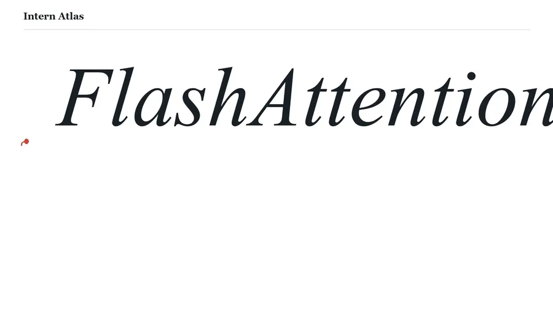
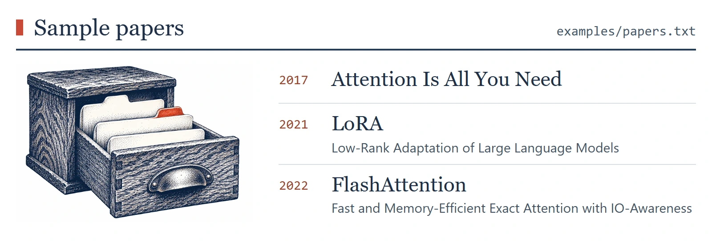
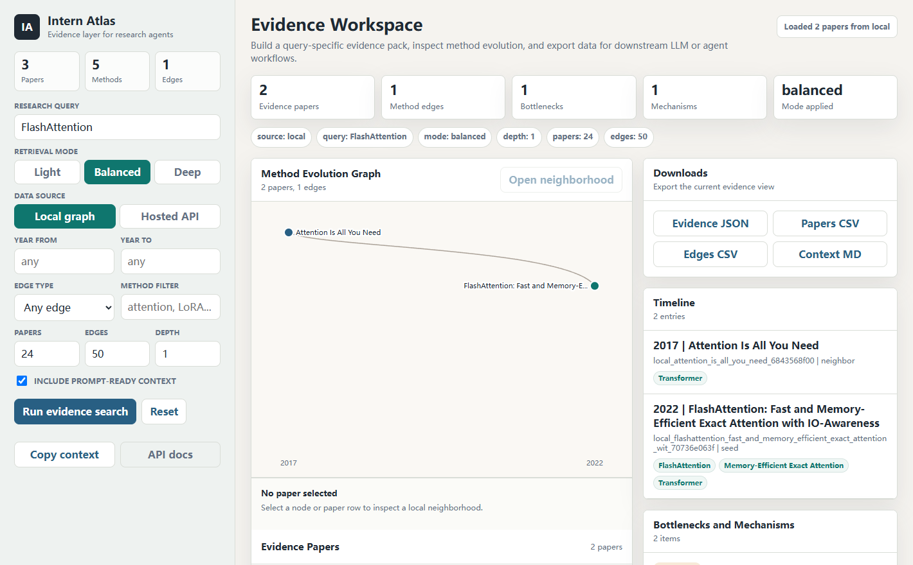
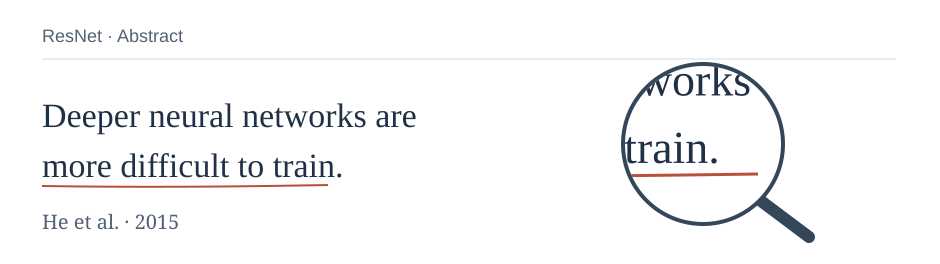
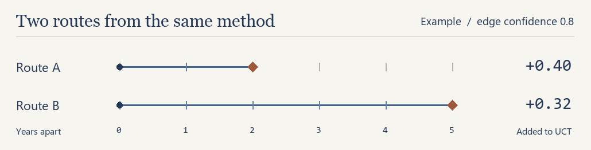
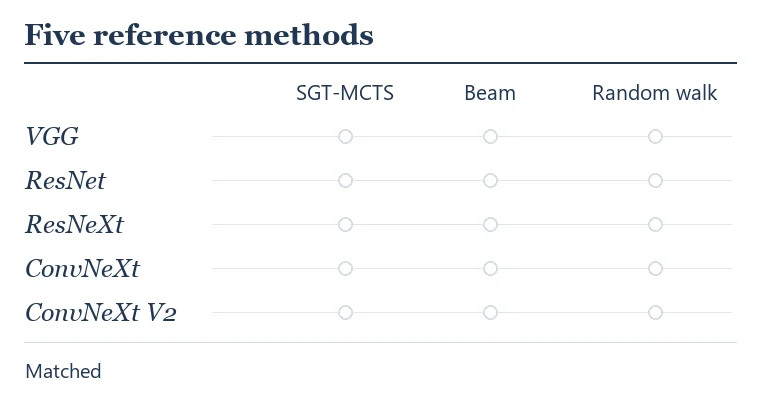

<p align="center"><picture><source media="(prefers-color-scheme: dark)" srcset="assets/logo-dark.svg"></picture></p>

<p align="center"><strong>English</strong> · <a href="README.zh-CN.md">简体中文</a></p>

<p align="center">A graph of research methods and the papers that connect them.</p>

<p align="center"><strong><a href="https://intern-atlas.opendatalab.org.cn/">Browse the atlas ↗</a></strong> &nbsp; / &nbsp; <a href="https://arxiv.org/abs/2604.28158">Paper</a> &nbsp; / &nbsp; <a href="https://huggingface.co/datasets/OpenRaiser/Intern-Atlas">Dataset</a> &nbsp; / &nbsp; <a href="docs/API_USAGE.md">API docs</a></p>

<p align="center"><a href="https://cdn.jsdelivr.net/gh/OpenRaiser/Intern-Atlas@4d7d8bd04cb0783754046bec0e1e3392af55b9e6/assets/workspace-tour.mp4"><picture><source media="(prefers-reduced-motion: reduce)" srcset="assets/workspace-tour-cover.png"></picture></a><br><a href="https://cdn.jsdelivr.net/gh/OpenRaiser/Intern-Atlas@4d7d8bd04cb0783754046bec0e1e3392af55b9e6/assets/workspace-tour.mp4">Watch with sound · 1080p · 23 seconds</a></p>

---

[Quick start](#quick-start) · [Read the research guide](#how-the-research-graph-works) · [Query the hosted graph](#query-the-hosted-graph)

## Quick start

**Install.** Use Python 3.10 or later. On macOS or Linux, run these commands in Bash.

```bash
git clone https://github.com/OpenRaiser/Intern-Atlas.git
cd Intern-Atlas
python -m venv .venv
source .venv/bin/activate
python -m pip install -e .
```

<details>
<summary>Install on Windows with PowerShell</summary>

```powershell
git clone https://github.com/OpenRaiser/Intern-Atlas.git
cd Intern-Atlas
python -m venv .venv
.\.venv\Scripts\python.exe -m pip install -e .
```

From the repository root in this PowerShell session, replace the CLI executable `intern-atlas` with `.\.venv\Scripts\intern-atlas.exe`.

</details>

**Build the graph.** Start with a fresh `outputs/smoke.db` and the [three sample abstracts](examples/papers.txt). The `--no-llm` option uses local rules and needs no API key.

<p align="center"><a href="examples/papers.txt"><picture><source media="(max-width: 600px)" srcset="assets/sample-index-mobile.webp"></picture></a></p>

```bash
intern-atlas build --input examples/papers.txt --out outputs/smoke.db --json outputs/smoke.json --no-llm
```

> **Expected result**　3 papers · 5 method entries · 1 candidate edge.

In `outputs/smoke.json`, the FlashAttention paper points to *Attention Is All You Need*. The two records share the extracted method name `Transformer`, which triggers the heuristic label `extends`.

<details>
<summary>Inspect the extracted methods and edge</summary>

Run these commands from the repository root after building the sample.

```bash
python -c "import json; g=json.load(open('outputs/smoke.json', encoding='utf-8')); print([m['canonical_name'] for m in g['methods']])"
python -c "import json; g=json.load(open('outputs/smoke.json', encoding='utf-8')); print(g['edges'][0])"
```

The uppercase-name rule also picks up the conference name `ICLR`. The candidate edge scores **0.61** from overlap in method names, titles and abstracts, using `min(0.65, 0.35 + score / 20)`. The heuristic supplies fixed text for the bottleneck and mechanism fields. [Candidate selection and scoring](https://github.com/OpenRaiser/Intern-Atlas/blob/1185dc36555c547b5b6e9553779cb498a15ce587/src/intern_atlas/builder.py#L202)

</details>

**Start the workspace.**

```bash
intern-atlas serve --db outputs/smoke.db --host 127.0.0.1 --port 8000
```

Keep the server running and open [the local workspace](http://127.0.0.1:8000/). Enter `FlashAttention` and select **Run evidence search**. The sample returns two papers connected by one edge. Select a paper to inspect its neighborhood, or export the result as JSON, CSV or Markdown.

<details>
<summary>Preview the local workspace with the sample graph</summary>



</details>

## Build from your own papers

Set the API base URL, key and model in the terminal that will run the builder. The client appends `/chat/completions` to the base URL. In Bash:

```bash
export S4S_LLM_BASE_URL="https://your-openai-compatible-host/v1"
export S4S_LLM_API_KEY="YOUR_API_KEY"
export S4S_LLM_MODELS="gpt-4o-mini"
```

<details>
<summary>Set the same variables in PowerShell</summary>

```powershell
$env:S4S_LLM_BASE_URL = "https://your-openai-compatible-host/v1"
$env:S4S_LLM_API_KEY = "YOUR_API_KEY"
$env:S4S_LLM_MODELS = "gpt-4o-mini"
```

The multiline CLI and curl examples below use Bash syntax. In PowerShell, enter CLI arguments on one line.

</details>

Keep API keys, `.env` files, generated databases and PDF corpora out of version control.

The builder extracts method names, selects up to 120 candidate pairs by word overlap, and sends a summary of each pair to the model. If a classification call fails, the builder scores that pair with the heuristic. The build summary records whether a model client was configured in `llm_used`. [Builder](https://github.com/OpenRaiser/Intern-Atlas/blob/1185dc36555c547b5b6e9553779cb498a15ce587/src/intern_atlas/builder.py#L66) · [CLI defaults](https://github.com/OpenRaiser/Intern-Atlas/blob/1185dc36555c547b5b6e9553779cb498a15ce587/src/intern_atlas/cli.py#L28)

For fallback models, set `S4S_LLM_MODELS` to a comma-separated list such as `model-a,model-b,model-c`.

**From a folder of PDFs** — the example reads up to eight pages per paper.

```bash
intern-atlas build \
  --pdf-dir ./papers \
  --out outputs/local_graph.db \
  --json outputs/local_graph.json \
  --max-pdf-pages 8
```

**Alternative input: titles and abstracts.** Choose this build or the PDF build above for the same output path.

```bash
intern-atlas build \
  --input examples/papers.txt \
  --out outputs/local_graph.db \
  --json outputs/local_graph.json
```

| Input | Expected layout |
| --- | --- |
| PDF | A directory of papers passed to `--pdf-dir` |
| TXT | Repeated `Title:`, `Year:` and `Abstract:` blocks |
| JSON / JSONL | Paper records with fields such as `paper_id`, `title`, `abstract`, `year`, `authors` and `venue` |
| CSV | At least `title` and `abstract` columns |

Use a fresh `--out` path for a clean build. Reusing a database can retain records from previous inputs. Add `--json` for a portable export. [Local graph builder guide](docs/LOCAL_GRAPH_BUILDER.md)

<details>
<summary><strong>Inside the SQLite graph</strong></summary>

| Table | What you can trace |
| --- | --- |
| `papers` | Source papers and their metadata |
| `methods` | Normalized method names extracted from the corpus |
| `method_aliases` | Normalized lookup keys and display names recorded from local method mentions |
| `paper_methods` | Which papers introduce, use, extend or compare a method |
| `citations` | How papers build on one another through relationships such as `extends`, `improves`, `replaces`, `adapts`, `combines` and `uses_component` |

</details>

## Retrieve evidence locally


Leave the sample server running. In a second Bash terminal, query the same database:

```bash
curl -X POST "http://127.0.0.1:8000/api/v1/evidence/context" \
  -H "Content-Type: application/json" \
  -d '{"query":"FlashAttention","mode":"balanced"}'
```

On the bundled sample, `papers` contains two records and `method_edges` contains their inferred link. Use `suggested_prompt_context` for the text prepared for a research agent. On your own corpus, add filters such as `year_from` or limits such as `max_papers` to the request.

To switch to a database you built from your own papers, stop the sample server with Ctrl+C in its original terminal. Then run:

```bash
intern-atlas serve --db outputs/local_graph.db --host 127.0.0.1 --port 8000
```

[Browser workspace](http://127.0.0.1:8000/) · [Interactive API docs](http://127.0.0.1:8000/api/docs) · [Health](http://127.0.0.1:8000/api/health) · [Graph statistics](http://127.0.0.1:8000/api/stats)

<details>
<summary><strong>Paper search, method search and agent integration</strong></summary>

```bash
curl "http://127.0.0.1:8000/api/papers/search?q=attention"
curl "http://127.0.0.1:8000/api/methods?q=Transformer"
curl -X POST "http://127.0.0.1:8000/api/assist/context" \
  -H "Content-Type: application/json" \
  -d '{"query":"efficient attention","max_nodes":80}'
```

Use the versioned endpoints when connecting an LLM or research agent.

| Request | Purpose |
| --- | --- |
| `POST /api/v1/evidence/context` | Assemble evidence for a research query |
| `GET /api/v1/methods/search` | Resolve a method name |
| `GET /api/v1/evolution/edges` | Find relationships between papers |
| `GET /api/v1/papers/{paper_id}/neighborhood` | Explore the papers around one result |
| `GET /api/v1/llm/tools` | Inspect the available tools |

Retrieval controls include mode, year range, edge type, method, graph depth and limits on papers and edges. [LLM tool integration guide](docs/LLM_TOOL_INTEGRATION.md)

</details>

## Query the hosted graph

After installation, the CLI targets the public service by default. Run these commands directly to search the hosted graph and retrieve an evolution chain.

```bash
intern-atlas remote health
intern-atlas remote search "FlashAttention" --include-subgraph
intern-atlas remote chain "attention" --max-chains 5
```

<details>
<summary><strong>Evidence retrieval, idea generation and evaluation</strong></summary>

```bash
intern-atlas remote evidence "efficient long-context attention"

intern-atlas remote context "efficient long-context attention"

intern-atlas remote methods "Transformer"

intern-atlas remote edges --method attention --limit 20

intern-atlas remote ideas "long-context efficient attention" --use-llm

intern-atlas remote eval \
  "Use FlashAttention and LoRA for parameter-efficient vision transformer tuning."
```

```bash
intern-atlas remote query "efficient attention" --max-nodes 80
```

</details>

<details>
<summary><strong>Use your own deployment or connect through the browser</strong></summary>

To use a different deployment, set its URL. Set the API key only if that deployment requires authentication.

```bash
export INTERN_ATLAS_REMOTE_BASE_URL="https://your-host.example.com/api"
export INTERN_ATLAS_API_KEY="YOUR_ATLAS_API_KEY"
```

To override the endpoint once, pass `--base-url` after the remote subcommand, for example `intern-atlas remote health --base-url https://your-host.example.com/api`. If the public demo returns an upstream error, point the client at your own deployment.

In the local workspace, choose **Hosted API** in the sidebar and enter the base URL and optional key. The workspace sends requests through the local FastAPI proxy. To use that proxy directly, run the local server and call:

```bash
curl -X POST "http://127.0.0.1:8000/api/v1/remote/evidence/context" \
  -H "Content-Type: application/json" \
  -d '{"query":"efficient attention","mode":"deep","base_url":"https://intern-atlas.opendatalab.org.cn/"}'
```

</details>

[Hosted API reference](https://jcnc4nyy2d5p.feishu.cn/wiki/EL1sw9XqAizaCYkGoxpcPAoNnKc) · [Endpoint guide and Python examples](docs/API_USAGE.md)

<p align="center"></p>

## How the research graph works

<p align="center"><a href="https://arxiv.org/abs/1512.03385"></a></p>

### Which graph are you inspecting?

| Object | Where a link comes from | How to interpret it |
| --- | --- | --- |
| Local `--no-llm` output | A rule compares pairs of supplied papers | Inspect the two inputs and the score. A row in `citations` can exist without a parsed bibliographic citation. |
| Local model-assisted output | A model classifies shortlisted pairs from paper summaries, with per-pair heuristic fallback on errors | Inspect the descriptions against your papers. The local writer initializes `contexts_json` as an empty list. |
| Research graph in the paper | References resolved from the corpus, classified using the citing text and enriched with evidence | Use the source passage to assess whether the reported relation and its direction are justified. |

[Local pair classifier](https://github.com/OpenRaiser/Intern-Atlas/blob/1185dc36555c547b5b6e9553779cb498a15ce587/src/intern_atlas/builder.py#L269) · [SQLite writer](https://github.com/OpenRaiser/Intern-Atlas/blob/1185dc36555c547b5b6e9553779cb498a15ce587/src/intern_atlas/db.py#L144) · [Research pipeline](https://arxiv.org/html/2604.28158v2#S3.SS2)

### From a citation to a traversable edge

When a paper cites an older architecture as a baseline, Intern Atlas labels the citation `compares`. When the authors build on that architecture, the citation may lead to an earlier method in its lineage.

1. **Resolve the entities.** Alias resolution maps different names for a method to one canonical node. A citation to a work outside the corpus can terminate at a stub. The authors report 1,030,314 papers, 8,155 canonical methods and 9,410,201 typed edges in the research graph. [Graph construction](https://arxiv.org/html/2604.28158v2#S3.SS2)
2. **Classify the citation.** The first model pass reads the citing text and references. Lineage search follows four labels: `extends`, `improves`, `replaces` and `adapts`. The remaining labels record component reuse, comparisons and background. [Edge definitions](https://arxiv.org/html/2604.28158v2#A1.T5)
3. **Attach the evidence.** For each non-background candidate, a second pass extracts the bottleneck, mechanism and trade-off, along with a confidence score. A validator checks the quoted spans against the citing text. In the authors’ audit, the production model assigned the correct edge type in **70.4%** of cases. [Extraction protocol](https://arxiv.org/html/2604.28158v2#A1.SS3) · [Limitations](https://arxiv.org/html/2604.28158v2#A6)

**Component reuse.** If method B uses module A, the method graph stores A → B as `component_of`. Citations labeled `compares` remain available for retrieval. [Projection rules, Table 6](https://arxiv.org/html/2604.28158v2#A1.T6)

### How a branch gets selected

At a method with several eligible neighbors, SGT-MCTS balances promising routes with less visited ones. It adds a graph-specific term to the usual UCT score:

`selection score = UCT + 0.5 × edge confidence × temporal coherence`

For example, take two hypothetical edges with confidence 0.8 and the same UCT score. A two-year gap contributes **0.40** to selection. A five-year gap contributes **0.32**. The preference can change which branch gets explored first. Because the time prior was calibrated on post-2015 AI work, a field with longer research cycles could warrant different weights. [Selection rule](https://arxiv.org/html/2604.28158v2#S3.SS3.SSS1) · [Parameters](https://arxiv.org/html/2604.28158v2#A2)



SGT-MCTS runs 200 iterations per seed in each direction. It joins backward and forward paths and ranks them by length, mean edge confidence and visit count. To explore another route at a fork, it masks edges already covered and searches again with half the budget. [Search procedure](https://arxiv.org/html/2604.28158v2#A2)

### Case study: from ConvNeXt V2 to VGG

**Start from ConvNeXt V2. Can you trace it back to VGG?** Three searches start from the same method. Beam search reaches ResNet via Highway Networks and recovers ResNeXt, ConvNeXt and ConvNeXt V2. Its path omits VGG. Random walk finds ResNet and misses ResNeXt. SGT-MCTS recovers all five reference methods in order. [ConvNet case study, Table 8](https://arxiv.org/html/2604.28158v2#A5.T8)

<picture><source media="(prefers-reduced-motion: reduce)" srcset="assets/search-scorecard.png"></picture>

Each blue mark is a match to one of the five reference methods. The SGT-MCTS path also includes Caffe before VGG and a downstream recognition paper after ConvNeXt V2.

### What the benchmark measures

The benchmark contains 133 reference chains from 30 surveys. An LLM extracted candidate chains, and domain researchers checked method names, relations and their direction against the surveys. [Benchmark construction](https://arxiv.org/html/2604.28158v2#A4.SS1)

**Graph coverage.** Intern Atlas matched 91.0% of reference nodes. For 89.7% of reference relations, the authors found a directed path between the two endpoints. That path can pass through intermediate methods. [Graph quality](https://arxiv.org/html/2604.28158v2#S4.SS1)

**Lineage search.** Edge recall counts adjacent steps recovered from a reference chain. SGT-MCTS scored 79.0 and Beam@10 scored 23.2, a difference of **55.8 points**. [All configurations, Table 1](https://arxiv.org/html/2604.28158v2#S4.T1)

| Search | Node recall (NR) | Edge recall (ER) | Chain alignment score (CAS) |
| --- | ---: | ---: | ---: |
| Beam, width 10 | 44.9 | 23.2 | 44.9 |
| SGT-MCTS | 84.8 | 79.0 | 84.8 |

### What a research agent can do with the evidence

**Idea evaluation.** The evaluator scores novelty, feasibility, significance, validity and clarity. On 100 idea profiles rated by 10 AI PhD researchers, the Spearman correlation with expert overall ratings was **0.81** for Intern Atlas and **0.58** for the LLM-only judge. [Idea evaluation](https://arxiv.org/html/2604.28158v2#S4.SS2)

**Idea generation.** The generator can propose a way to address an open bottleneck or revisit a recurring trade-off. Each proposal identifies a graph edge, quotes its stored bottleneck and explains why the problem remains open. If the quote fails an exact match, the pipeline builds a fallback proposal from the stored evidence. [Generation procedure](https://arxiv.org/html/2604.28158v2#S3.SS3.SSS3)

Across 100 questions, the authors kept the generation pipeline fixed and varied its source material. Their idea evaluator gave Intern Atlas a mean overall score of **7.20**, followed by Semantic Scholar (6.18), BM25 retrieval (6.15), OpenAlex (6.03) and generation without external knowledge (5.78). [Experiment and Table 3](https://arxiv.org/html/2604.28158v2#S4.T3)

In the separate blind expert comparison, the authors report an **81% overall win rate** against BM25. Experts could choose either anonymized proposal or declare a tie. [Figure 5b](https://arxiv.org/html/2604.28158v2#S4.F5) · [Expert protocol](https://arxiv.org/html/2604.28158v2#A4.SS4)

To explore a lineage, try the [hosted chain and evidence queries](#query-the-hosted-graph).

## License

The toolkit is distributed under the [MIT License](LICENSE).

<p align="right"><picture><source media="(prefers-reduced-motion: reduce)" srcset="assets/one-more-paper.webp"></picture></p>
