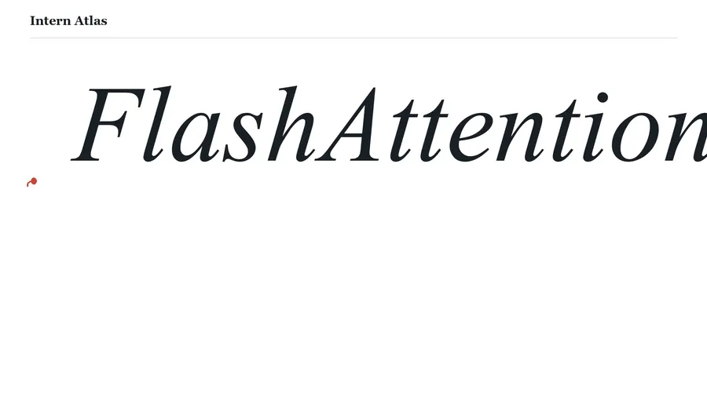
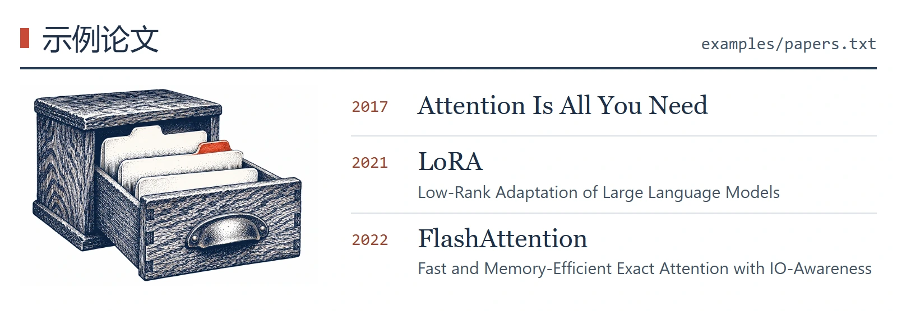
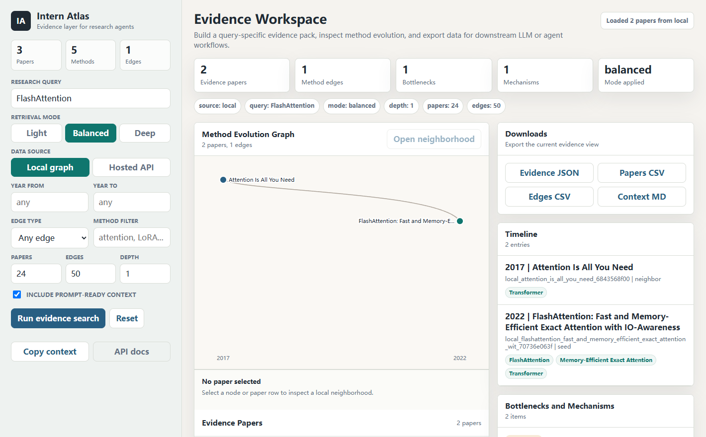
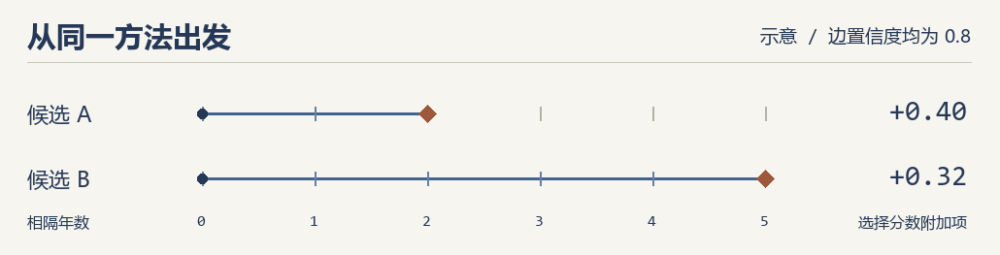
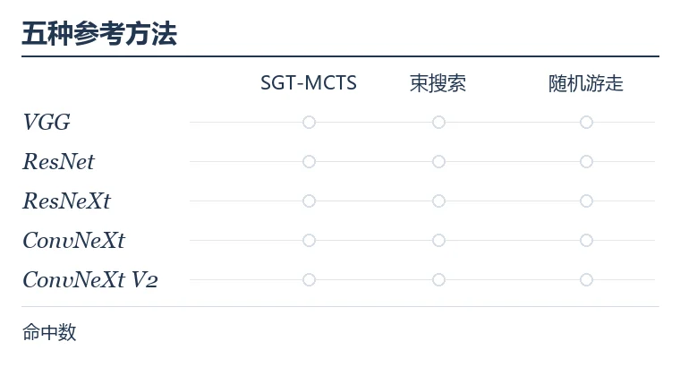

<p align="center"><picture><source media="(prefers-color-scheme: dark)" srcset="assets/logo-dark.svg"></picture></p>

<p align="center"><a href="README.md">English</a> · <strong>简体中文</strong></p>

<p align="center">沿着论文之间的引用，追溯一个研究方法如何演变。</p>

<p align="center"><strong><a href="https://intern-atlas.opendatalab.org.cn/">浏览图谱 ↗</a></strong> &nbsp; / &nbsp; <a href="https://arxiv.org/abs/2604.28158">论文</a> &nbsp; / &nbsp; <a href="https://huggingface.co/datasets/OpenRaiser/Intern-Atlas">数据集</a> &nbsp; / &nbsp; <a href="docs/API_USAGE.md">API 文档</a></p>

<p align="center"><a href="https://cdn.jsdelivr.net/gh/OpenRaiser/Intern-Atlas@4d7d8bd04cb0783754046bec0e1e3392af55b9e6/assets/workspace-tour-zh.mp4"><picture><source media="(prefers-reduced-motion: reduce)" srcset="assets/workspace-tour-zh-cover.png"></picture></a><br><a href="https://cdn.jsdelivr.net/gh/OpenRaiser/Intern-Atlas@4d7d8bd04cb0783754046bec0e1e3392af55b9e6/assets/workspace-tour-zh.mp4">播放 1080p 有声版（23 秒）</a></p>

---

[快速开始](#快速开始) · [了解研究图谱](#研究图谱的工作原理) · [查询在线图谱](#查询在线图谱)

## 快速开始

**安装。** 需要 Python 3.10 或更高版本。macOS 和 Linux 用户在 Bash 中运行：

```bash
git clone https://github.com/OpenRaiser/Intern-Atlas.git
cd Intern-Atlas
python -m venv .venv
source .venv/bin/activate
python -m pip install -e .
```

<details>
<summary>在 Windows 上用 PowerShell 安装</summary>

```powershell
git clone https://github.com/OpenRaiser/Intern-Atlas.git
cd Intern-Atlas
python -m venv .venv
.\.venv\Scripts\python.exe -m pip install -e .
```

在当前 PowerShell 窗口中，从仓库根目录运行后续命令，并将命令开头的 `intern-atlas` 换成 `.\.venv\Scripts\intern-atlas.exe`。

</details>

**建图。** 用仓库里的[三篇摘要](examples/papers.txt)创建本地数据库。首次运行时，使用一个尚不存在的 `outputs/smoke.db`。`--no-llm` 使用本地规则，无需 API 密钥。

<p align="center"><a href="examples/papers.txt"><picture><source media="(max-width: 600px)" srcset="assets/sample-index-zh-mobile.webp"></picture></a></p>

```bash
intern-atlas build --input examples/papers.txt --out outputs/smoke.db --json outputs/smoke.json --no-llm
```

> **预期结果**　3 篇论文 · 5 条方法记录 · 1 条候选关系。

打开 `outputs/smoke.json`，可以看到一条从 FlashAttention 论文指向 *Attention Is All You Need* 的记录。两篇论文中都提取出了方法名 `Transformer`，因此规则给这条候选关系打上了 `extends` 标签。

<details>
<summary>查看抽取出的方法和候选关系</summary>

构建完成后，在仓库根目录运行以下命令。

```bash
python -c "import json; g=json.load(open('outputs/smoke.json', encoding='utf-8')); print([m['canonical_name'] for m in g['methods']])"
python -c "import json; g=json.load(open('outputs/smoke.json', encoding='utf-8')); print(g['edges'][0])"
```

大写词匹配规则也把会议名 `ICLR` 当作方法收了进来。候选关系按方法名、标题和摘要中的词汇重合程度计分，代入 `min(0.65, 0.35 + score / 20)` 得到 **0.61**。在这个例子里，瓶颈和机制两个字段填入的是规则预设的文字。[候选筛选与计分代码](https://github.com/OpenRaiser/Intern-Atlas/blob/1185dc36555c547b5b6e9553779cb498a15ce587/src/intern_atlas/builder.py#L202)

</details>

**启动工作台。**

```bash
intern-atlas serve --db outputs/smoke.db --host 127.0.0.1 --port 8000
```

保持服务运行，打开[本地工作台](http://127.0.0.1:8000/)。输入 `FlashAttention` 并点击 **Run evidence search**。结果中有两篇论文和一条连线。选中论文可以查看相邻论文，也可以将结果导出为 JSON、CSV 或 Markdown。

<details>
<summary>查看本地工作台完整截图</summary>



</details>

## 用自己的论文建图

在运行构建器的终端中设置 API 地址、密钥和模型名。客户端会在基础地址末尾追加 `/chat/completions`。以下为 Bash 写法。

```bash
export S4S_LLM_BASE_URL="https://your-openai-compatible-host/v1"
export S4S_LLM_API_KEY="YOUR_API_KEY"
export S4S_LLM_MODELS="gpt-4o-mini"
```

<details>
<summary>在 PowerShell 中设置同样的环境变量</summary>

```powershell
$env:S4S_LLM_BASE_URL = "https://your-openai-compatible-host/v1"
$env:S4S_LLM_API_KEY = "YOUR_API_KEY"
$env:S4S_LLM_MODELS = "gpt-4o-mini"
```

下文的多行 CLI 和 curl 示例使用 Bash 的续行语法。在 PowerShell 中，请将同一条命令及其参数写在一行。

</details>

请将 API 密钥、`.env` 文件、生成的数据库和 PDF 语料保存在版本库之外。

构建器先抽取方法名，按词汇重合程度选出最多 120 对候选论文，再把每对论文的摘要信息发给模型分类。某次分类调用失败时，该论文对会改用规则计分。构建结果里的 `llm_used` 表示是否配置了模型客户端。[构建代码](https://github.com/OpenRaiser/Intern-Atlas/blob/1185dc36555c547b5b6e9553779cb498a15ce587/src/intern_atlas/builder.py#L66) · [CLI 默认参数](https://github.com/OpenRaiser/Intern-Atlas/blob/1185dc36555c547b5b6e9553779cb498a15ce587/src/intern_atlas/cli.py#L28)

如需备用模型，可把 `S4S_LLM_MODELS` 设为逗号分隔的列表，例如 `model-a,model-b,model-c`。

**从 PDF 目录读取。** 以下命令每篇最多读八页。

```bash
intern-atlas build \
  --pdf-dir ./papers \
  --out outputs/local_graph.db \
  --json outputs/local_graph.json \
  --max-pdf-pages 8
```

**从标题和摘要读取。** 此命令与上面的 PDF 示例写入同一数据库路径，两者选用一种即可。

```bash
intern-atlas build \
  --input examples/papers.txt \
  --out outputs/local_graph.db \
  --json outputs/local_graph.json
```

| 输入格式 | 文件内容 |
| --- | --- |
| PDF | 用 `--pdf-dir` 指定存放论文的目录 |
| TXT | 每篇论文一组 `Title:`、`Year:` 和 `Abstract:` |
| JSON / JSONL | 论文记录，可包含 `paper_id`、`title`、`abstract`、`year`、`authors`、`venue` 等字段 |
| CSV | 至少包含 `title` 和 `abstract` 两列 |

如果要从头建图，请为 `--out` 指定新路径。复用数据库可能会保留此前导入的记录。加上 `--json` 可同时导出一份便于传递的文件。[本地建图指南](docs/LOCAL_GRAPH_BUILDER.md)

<details>
<summary><strong>查看 SQLite 图谱中的表</strong></summary>

| 表名 | 记录内容 |
| --- | --- |
| `papers` | 原始论文及其元数据 |
| `methods` | 从这批论文中抽取并规范化的方法名 |
| `method_aliases` | 论文中提及的方法名称及其规范化检索键 |
| `paper_methods` | 哪篇论文提出、使用、扩展或比较了某种方法 |
| `citations` | 论文之间的关系，如 `extends`、`improves`、`replaces`、`adapts`、`combines` 和 `uses_component` |

</details>

## 在本地检索证据


保持示例服务运行，在另一个 Bash 窗口中查询同一个数据库。

```bash
curl -X POST "http://127.0.0.1:8000/api/v1/evidence/context" \
  -H "Content-Type: application/json" \
  -d '{"query":"FlashAttention","mode":"balanced"}'
```

在随附示例中，`papers` 返回两条记录，`method_edges` 给出规则推断出的连接。`suggested_prompt_context` 是可直接交给研究智能体的文本。查询自己的语料时，可以用 `year_from` 限定起始年份，用 `max_papers` 限定论文数。

要切换到自己构建的数据库，请在原终端按 Ctrl+C 停止示例服务，然后运行以下命令。

```bash
intern-atlas serve --db outputs/local_graph.db --host 127.0.0.1 --port 8000
```

[浏览器工作台](http://127.0.0.1:8000/) · [交互式 API 文档](http://127.0.0.1:8000/api/docs) · [服务状态](http://127.0.0.1:8000/api/health) · [图谱统计](http://127.0.0.1:8000/api/stats)

<details>
<summary><strong>检索论文和方法，接入研究智能体</strong></summary>

```bash
curl "http://127.0.0.1:8000/api/papers/search?q=attention"
curl "http://127.0.0.1:8000/api/methods?q=Transformer"
curl -X POST "http://127.0.0.1:8000/api/assist/context" \
  -H "Content-Type: application/json" \
  -d '{"query":"efficient attention","max_nodes":80}'
```

接入大语言模型或研究智能体时，使用带版本号的接口。

| 请求 | 用途 |
| --- | --- |
| `POST /api/v1/evidence/context` | 为研究问题汇集证据 |
| `GET /api/v1/methods/search` | 查找方法名对应的记录 |
| `GET /api/v1/evolution/edges` | 查找论文之间的关系 |
| `GET /api/v1/papers/{paper_id}/neighborhood` | 查看一篇论文附近的节点和关系 |
| `GET /api/v1/llm/tools` | 查看可用工具 |

检索时可以设置模式、年份范围、关系类型、方法名、图的搜索深度，以及论文和关系的数量上限。[模型工具接入指南](docs/LLM_TOOL_INTEGRATION.md)

</details>

## 查询在线图谱

安装后，CLI 默认连接公共服务。下面三条命令依次检查服务状态、搜索论文并获取方法演化链。

```bash
intern-atlas remote health
intern-atlas remote search "FlashAttention" --include-subgraph
intern-atlas remote chain "attention" --max-chains 5
```

<details>
<summary><strong>检索证据、生成与评估研究设想</strong></summary>

```bash
intern-atlas remote evidence "efficient long-context attention"

intern-atlas remote context "efficient long-context attention"

intern-atlas remote methods "Transformer"

intern-atlas remote edges --method attention --limit 20

intern-atlas remote ideas "long-context efficient attention" --use-llm

intern-atlas remote eval \
  "Use FlashAttention and LoRA for parameter-efficient vision transformer tuning."
```

```bash
intern-atlas remote query "efficient attention" --max-nodes 80
```

</details>

<details>
<summary><strong>连接自己的部署，或从浏览器访问</strong></summary>

连接其他部署时，将基础地址设为该服务的 URL。如果该部署要求身份验证，再设置 API 密钥。

```bash
export INTERN_ATLAS_REMOTE_BASE_URL="https://your-host.example.com/api"
export INTERN_ATLAS_API_KEY="YOUR_ATLAS_API_KEY"
```

如需临时更换地址，将 `--base-url` 放在远程子命令之后，例如 `intern-atlas remote health --base-url https://your-host.example.com/api`。若公共演示服务返回上游错误，也可以将客户端指向自己的部署。

在本地工作台侧栏选择 **Hosted API**，填写基础地址和可选的密钥。浏览器会通过本地 FastAPI 服务转发请求。也可以启动本地服务后，直接调用代理接口。

```bash
curl -X POST "http://127.0.0.1:8000/api/v1/remote/evidence/context" \
  -H "Content-Type: application/json" \
  -d '{"query":"efficient attention","mode":"deep","base_url":"https://intern-atlas.opendatalab.org.cn/"}'
```

</details>

[在线 API 参考](https://jcnc4nyy2d5p.feishu.cn/wiki/EL1sw9XqAizaCYkGoxpcPAoNnKc) · [接口指南与 Python 示例](docs/API_USAGE.md)

<p align="center"></p>

## 研究图谱的工作原理

<p align="center"><a href="https://arxiv.org/abs/1512.03385"></a></p>

### 你正在看哪一种图？

| 图谱来源 | 关系如何生成 | 怎样阅读结果 |
| --- | --- | --- |
| 本地离线模式（`--no-llm`） | 规则对输入论文两两比较 | 对照两篇输入论文及其得分。即使没有解析出参考文献，`citations` 表里也可能有候选关系。 |
| 本地模型辅助模式 | 模型根据摘要信息对候选论文对分类，单次调用出错时改用规则 | 将关系描述与原文对照。本地写入器会把 `contexts_json` 初始化为空列表。 |
| 论文中的研究图谱 | 从语料中解析参考文献，根据引用处的文字分类，并附上证据 | 阅读引用原文，判断它能否支持这条关系及其方向。 |

[本地论文对分类器](https://github.com/OpenRaiser/Intern-Atlas/blob/1185dc36555c547b5b6e9553779cb498a15ce587/src/intern_atlas/builder.py#L269) · [SQLite 写入逻辑](https://github.com/OpenRaiser/Intern-Atlas/blob/1185dc36555c547b5b6e9553779cb498a15ce587/src/intern_atlas/db.py#L144) · [论文中的建图流程](https://arxiv.org/html/2604.28158v2#S3.SS2)

### 一条引用如何成为图中可追溯的边

同样是引用旧架构，拿它当对照基线时，引用会被标为 `compares`；在它的基础上改进方法时，这条引用就可能成为追溯前代方法的线索。

1. **确定引用指向谁。** 别名消歧会把同一方法的不同名称归到一个规范节点。引用指向语料以外的文献时，图中可以保留一个占位节点。作者报告，研究图谱包含 1,030,314 篇论文、8,155 种规范化方法和 9,410,201 条带类型的边。[图谱构建](https://arxiv.org/html/2604.28158v2#S3.SS2)
2. **判断引用的用途。** 第一轮模型读取引用处的文字和参考文献。追溯谱系时会沿四类边搜索：`extends`、`improves`、`replaces` 和 `adapts`。其余标签记录组件复用、方法对比和背景引用。[关系类型定义](https://arxiv.org/html/2604.28158v2#A1.T5)
3. **把判断连回原文。** 对于非背景类的候选引用，第二轮抽取瓶颈、机制与取舍，并给出置信度。验证器再核对引文片段能否在原文中找到。在作者的抽查中，生产模型对边类型的判断有 **70.4%** 正确。[抽取流程](https://arxiv.org/html/2604.28158v2#A1.SS3) · [局限性](https://arxiv.org/html/2604.28158v2#A6)

**组件复用。** 如果方法 B 使用模块 A，方法图中会以 `component_of` 记录 A → B。`compares` 类型的引用也可用于检索。[投影规则，表 6](https://arxiv.org/html/2604.28158v2#A1.T6)

### 遇到分叉时，搜索走哪条路？

当一个方法有多个可选邻居时，SGT-MCTS 会兼顾有潜力的路径和访问较少的分支。它在常规 UCT 分数上加入了与边有关的一项。

`选择分数 = UCT + 0.5 × 边置信度 × 时间一致性`

假设两条候选边的置信度都为 0.8，UCT 分数也相同。论文间隔两年时，附加项为 **0.40**；间隔五年时为 **0.32**。这个差别就可能改变搜索顺序。时间先验依据 2015 年以后的 AI 研究校准，在研究周期更长的领域，权重可能需要调整。[选择规则](https://arxiv.org/html/2604.28158v2#S3.SS3.SSS1) · [参数说明](https://arxiv.org/html/2604.28158v2#A2)



SGT-MCTS 从每个种子节点分别向前、向后各迭代 200 次，再将两个方向的路径拼接起来，按路径长度、平均边置信度和访问次数排序。为了探索分叉处的其他路线，它会屏蔽已经覆盖的边，以一半的预算再次搜索。[搜索过程](https://arxiv.org/html/2604.28158v2#A2)

### 案例：从 ConvNeXt V2 到 VGG

**从 ConvNeXt V2 出发，能一路追溯到 VGG 吗？** 论文用三种算法从同一起点搜索。束搜索经过 Highway Networks 到达 ResNet，也找到了 ResNeXt、ConvNeXt 和 ConvNeXt V2，唯独漏掉 VGG。随机游走找到了 ResNet，却跳过了 ResNeXt。SGT-MCTS 按参考顺序找全了五种方法。[卷积网络案例，表 8](https://arxiv.org/html/2604.28158v2#A5.T8)

<picture><source media="(prefers-reduced-motion: reduce)" srcset="assets/search-scorecard-zh.png"></picture>

每个蓝色标记代表一种命中的参考方法。SGT-MCTS 的完整路径还包括 VGG 之前的 Caffe，以及 ConvNeXt V2 之后的一篇下游识别任务论文。

### 基准评测衡量什么？

基准包含来自 30 篇综述的 133 条参考谱系。大语言模型先抽取候选链，再由领域研究人员逐一对照综述，核查方法名、关系及其方向。[基准构建](https://arxiv.org/html/2604.28158v2#A4.SS1)

**图谱覆盖率。** Intern Atlas 匹配到了 91.0% 的参考节点。对于 89.7% 的参考关系，作者能在两端之间找到一条有向路径，沿途可以经过中间方法。[图谱质量](https://arxiv.org/html/2604.28158v2#S4.SS1)

**谱系搜索。** 边召回率衡量参考链中有多少相邻步骤被找回。SGT-MCTS 得分 79.0，宽度为 10 的束搜索得分 23.2，相差 **55.8 个百分点**。[全部搜索配置，表 1](https://arxiv.org/html/2604.28158v2#S4.T1)

| 搜索算法 | 节点召回率（NR） | 边召回率（ER） | 链对齐分数（CAS） |
| --- | ---: | ---: | ---: |
| 束搜索，宽度 10 | 44.9 | 23.2 | 44.9 |
| SGT-MCTS | 84.8 | 79.0 | 84.8 |

### 研究智能体怎样利用这些证据？

**评估研究设想。** 评估器从新颖性、可行性、重要性、有效性和清晰度五个维度打分。10 位 AI 方向的博士研究人员评审了 100 份设想。按综合评分计算，Intern Atlas 与专家的 Spearman 秩相关系数为 **0.81**，仅用大语言模型评分时为 **0.58**。[设想评估实验](https://arxiv.org/html/2604.28158v2#S4.SS2)

**生成研究设想。** 生成器可以围绕尚未解决的瓶颈提出思路，也可以重新审视反复出现的取舍。每个提案都指明一条图谱关系，引用其中记录的瓶颈，并解释问题为何仍未解决。如果引文无法精确匹配，流程会依据保存的证据生成备用提案。[生成流程](https://arxiv.org/html/2604.28158v2#S3.SS3.SSS3)

在 100 个研究问题上，作者固定生成流程，只改变提供给生成器的资料。评估器给 Intern Atlas 组的平均综合分为 **7.20**，其后依次为 Semantic Scholar（6.18）、BM25 检索（6.15）、OpenAlex（6.03）和不使用外部资料（5.78）。[实验与表 3](https://arxiv.org/html/2604.28158v2#S4.T3)

在另一项专家盲评中，评审者在两个匿名提案之间选择，也可以判为平局。作者报告，Intern Atlas 相对于 BM25 的**综合胜率为 81%**。[图 5b](https://arxiv.org/html/2604.28158v2#S4.F5) · [专家评审流程](https://arxiv.org/html/2604.28158v2#A4.SS4)

想亲自追一条方法谱系，可以从[在线演化链与证据查询](#查询在线图谱)开始。

## 许可证

本工具包采用 [MIT 许可证](LICENSE)。

<p align="right"><picture><source media="(prefers-reduced-motion: reduce)" srcset="assets/one-more-paper.webp"></picture></p>
